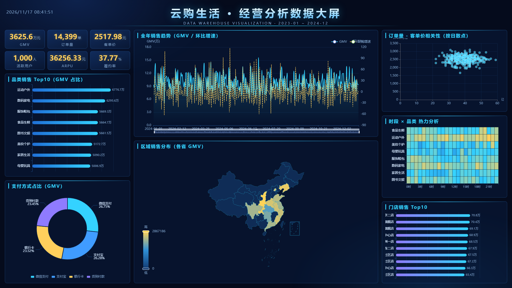

# Yundu Life Retail — Enterprise Data Warehouse & Analytics Visualization System

> Enterprise-grade offline data warehouse (ODS → DWD → DWS → ADS) with AI-powered analytics and visualization, built on the cloud-retail simulation dataset (60 stores · 1,000 members · 600 SKUs · 15,600 orders · 2024-06 ~ 2025-06).



## Architecture

```
CSV Sources ──► ODS (raw) ──► Clean ──► DWD (star schema, daily partitions)
                                   │
                                   ▼
                    DWS (pre-aggregates) ──► ADS (KPI tables)
                                   │
        ┌──────────────┬───────────┼──────────────┬─────────────┐
        ▼              ▼           ▼              ▼             ▼
  GMV Forecast    NL2SQL Q&A   AI Insights   ECharts Big    Superset
  (sklearn)       (LLM+pyhive) (LLM)        Screen (Flask)  Dashboard
        └──────────────┴───────────┴──────────────┴─────────────┘
                                   ▼
              Docker Compose: MySQL · Hive · ClickHouse · Superset · Streamlit
```

Four-layer warehouse model:

| Layer | Responsibility | Key Tables |
|---|---|---|
| ODS | Raw ingestion, 6 tables, row counts verified against data dictionary | ods_order (15,600), ods_order_item (37,549), ods_user_behavior (60,000) |
| DWD | Cleaning + star schema: 1 order fact + 1 order-item fact + 5 dims, partitioned by date | dwd_order (14,399), dwd_order_item (34,981) |
| DWS | Daily / store / member pre-aggregations | 6 summary tables |
| ADS | KPI & multi-dimensional analysis serving | 9 metric tables |

## Features

- **End-to-end verified pipeline** — every layer cross-checked: DWD GMV 36,256,326.33 = ADS KPI = region sum; daily average 99,061 × 366 days reconciled (see [联调核对清单](docs/端到端联调核对清单.md))
- **Thorough cleaning** — five dirty-data categories handled, repair rate 98.87% (see [清洗报告](docs/数据质量清洗报告.md))
- **Sales forecasting** — 7-day GMV prediction with LinearRegression, MAPE 13.89% vs 23.02% naive baseline
- **NL2SQL Q&A** — natural-language question → SQL → live Hive execution → auto chart; read-only enforcement blocks write requests (6/6 test cases passed)
- **AI insights** — LLM-generated management summaries, dual-tracked (AI draft + human verification)
- **ECharts big screen** — 1920×1080 adaptive, 7 charts incl. China province map (standard GB administrative GeoJSON incl. South China Sea islands)
- **Superset dashboard** — 8 charts + native filters, 3 datasources (Hive / ClickHouse / MySQL)
- **One-command deployment** — `docker compose up -d` brings up 6 services with healthcheck dependency chain; secrets injected via `.env` only

## Quick Start

```bash
# 1. Clone and configure
git clone https://github.com/SHY1119/yungou-dw.git
cd yungou-dw
cp .env.example .env          # fill in your LLM API key

# 2. Launch all services (MySQL, Hive Metastore/HS2, ClickHouse, Superset, Streamlit)
docker compose up -d
docker compose ps             # wait until all services are healthy

# 3. Build the warehouse (requires Hive CLI inside container)
docker exec hive-hiveserver2 bash /tmp/scripts/init_all.sh   # or run sql/* sequentially

# 4. Access the services
#   Streamlit Q&A:    http://localhost:8501
#   ECharts screen:   http://localhost:5000
#   Superset:         http://localhost:8088  (admin / set at init)
#   HiveServer2 JDBC: jdbc:hive2://localhost:10000
#   ClickHouse HTTP:  http://localhost:8123
```

See [部署手册](docs/部署手册.md) (Chinese) for troubleshooting and the six recorded deployment pitfalls.

## Tech Stack

| Category | Technology |
|---|---|
| Data Warehouse | Apache Hive 4.0.1 (Tez), ORC + Snappy |
| Metadata & Serving | MySQL 8.0, ClickHouse 24.8 (acceleration layer) |
| Modeling & Analysis | HiveQL, Python (pandas / scikit-learn) |
| AI Integration | LLM API (OpenAI-compatible) for NL2SQL & insights, pyhive direct mode |
| Visualization | Apache Superset 4.1.1, ECharts 5.5, Flask, Streamlit |
| Deployment | Docker Compose, healthcheck orchestration |
| Engineering | Git (Conventional Commits), GitHub PR/Issue workflow |

## Key Results

| Metric | Value |
|---|---|
| Cleaning repair rate | 98.87% |
| GMV (13 months) | ¥36.26 M · 14,399 orders · AOV ¥2,517.98 |
| Forecast accuracy | MAPE 13.89% (baseline 23.02%) |
| NL2SQL test pass | 6/6 + write-request interception verified |
| Query latency (4 concurrency) | pre-agg avg 4.62 s vs full-scan 6.08 s |

## Project Structure

```
yungou-dw/
├── docker-compose.yml    # 6-service orchestration (healthcheck chain)
├── sql/                  # ods / clean / dwd / dws / ads / eda / optimize / quality
├── scripts/              # forecast_gmv.py, stress_test.py, nl2sql/, insight.py
├── streamlit_app/        # NL2SQL Q&A app + Dockerfile
├── vis/                  # bigscreen (ECharts) + backend (Flask) + api_data
├── lib/                  # JDBC driver (bind-mounted into Hive images)
└── docs/                 # requirements, quality report, architecture, deployment, API guide
```

## Team

**Team Yundu-DS (云购数智队)** — "Data drives retail, wisdom creates life."

| Role | Member | Responsibility |
|---|---|---|
| Project Lead / DW Engineer | 孙浩瑜 (Sun Haoyu) | Architecture, ETL, Git management |
| Data Engineer | 孙浩瑜 | Ingestion, cleaning, ODS/DWD modeling |
| Data Analyst | 孙浩瑜 | Quality assessment, EDA, KPI definition |
| Visualization / DevOps | 孙浩瑜 | Docker deployment, dashboards, docs |

## License & Roadmap

- Stage status: Week 1–4 delivered ✅ · Week 5 integration & defense in progress
- Roadmap: incremental ingestion (schedule-triggered), data quality monitoring & alerting, ClickHouse materialized views for the big screen, multi-user NL2SQL with role-based access.

> This project was built as the capstone of the *Enterprise Project Practice* course (Data Science & Big Data program). All business data is simulated.
