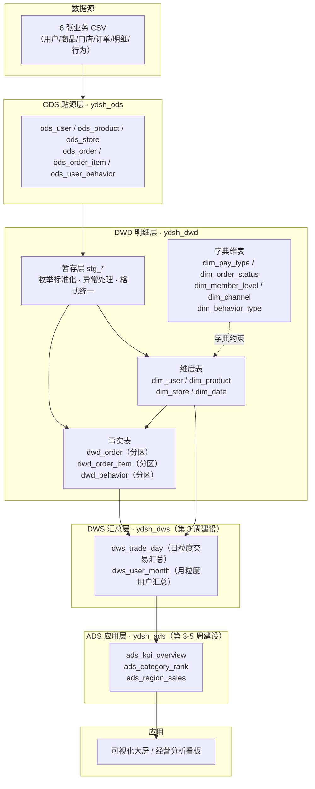
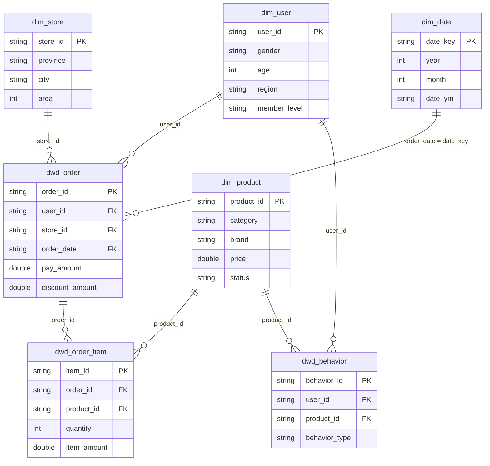

# 数仓架构设计文档

> 项目：云购生活新零售 —— 企业级数据仓库与经营分析可视化系统
> 团队：云购数智队　|　版本：v1.0（第 2 周）　|　日期：2026-11-02

## 一、总体架构

采用维度建模（Kimball）思路，按「贴源 → 明细 → 汇总 → 应用」四层组织，每层只依赖上一层，禁止跨层引用。



文本版数据流（便于快速对照）：

```
CSV ──LOAD DATA──▶ ODS（贴源，保留脏数据）
                      │
                      ├─ 02_enum_standardize  → stg_*_enum（枚举收敛）
                      ├─ 03_abnormal_format   → stg_*（异常/格式/字段合并）
                      └─ 04_dwd_model         → dim_* + dwd_*（星型模型，分区）
                                                    │
                                                    ▼
                                                 DWS（第 3 周）
                                                    │
                                                    ▼
                                                 ADS（第 3-5 周）──▶ 可视化
```

## 二、分层职责与规范

| 分层 | 定位 | 表名前缀 | 数据粒度 | 存储格式 | 分区策略 | 保留策略 |
|---|---|---|---|---|---|---|
| ODS 贴源层 | 原样接入，不做任何加工，保留全部脏数据用于追溯 | `ods_` | 业务最细粒度 | TEXTFILE（CSV） | 无分区 | 全量保留 |
| DWD 暂存层 | 清洗中间结果，可重跑、可回溯 | `stg_` | 同 ODS | ORC + SNAPPY | 无分区 | 可随时重建 |
| DWD 明细层 | 清洗标准化后的明细事实与维度，星型模型 | `dim_` / `dwd_` | 明细 | ORC + SNAPPY | 事实表按 `order_date` / `dt` 按天分区 | 全量保留 |
| DWS 汇总层 | 按主题轻度汇总，面向分析场景 | `dws_` | 日 / 月 + 维度 | ORC + SNAPPY | 按统计周期分区 | 3 年 |
| ADS 应用层 | 面向报表与看板的指标结果 | `ads_` | 指标级 | ORC + SNAPPY | 按天分区 | 1 年 |

### 命名规范

1. **库名**：`ydsh_` + 层名小写，如 `ydsh_ods`、`ydsh_dwd`
2. **表名**：`{层前缀}_{主题}_{粒度描述}`，如 `dwd_order`、`dws_trade_day`
3. **维度表**：统一 `dim_` 前缀；**字典维表**（枚举映射）同样归入 `dim_`
4. **字段名**：全小写下划线分隔；金额统一 `_amount` 结尾，数量统一 `quantity`，率值统一 `_rate` / `_pct` 结尾
5. **标记字段**：数据修复类标记统一 `{字段}_fixed` / `{字段}_abnormal` / `{字段}_missing`，取值 1/0
6. **日期字段**：`date_key` 表示维度主键，`{业务}_date` 表示事件日期，格式统一 `yyyy-MM-dd`

## 三、DWD 星型模型

### 模型结构



### 事实表与维度表的划分依据

| 类型 | 判定标准 | 本项目对应字段 |
|---|---|---|
| 事实（度量） | 可加、可聚合的数值 | `pay_amount`、`discount_amount`、`quantity`、`unit_price`、`item_amount` |
| 维度（描述） | 用于筛选、分组、打标签的属性 | `gender`、`age`、`category`、`brand`、`province`、`member_level`、`status` |

**粒度声明**：`dwd_order` 一行 = 一个订单；`dwd_order_item` 一行 = 一个订单中的一个商品；`dwd_behavior` 一行 = 一次用户行为事件。

### 代理键 vs 自然键

本项目采用**业务自然键**（`user_id`、`product_id`、`store_id`、`date_key`）作为维度主键，理由如下：

1. 源数据主键本身即为稳定字符串编码（`U000001`、`P00001`），不存在整型自增键的复用风险；
2. Hive 无自增序列，生成代理键需 `ROW_NUMBER()` 全表扫描，维度重跑时易与事实表错位；
3. 教学场景下自然键可读性更高，便于排查数据问题。

**代价**：若源系统主键发生变更（如用户 ID 重新编号），需要重建维度并回刷事实表。生产环境建议保留一层 `_sk` 代理键做解耦，本方案在文档中记录该权衡。

## 四、分区与存储策略

### 分区设计

| 表 | 分区字段 | 分区数（当前） | 单分区数据量 | 设计理由 |
|---|---|---|---|---|
| `dwd_order` | `order_date`（天） | 366 | 约 39 行 | 业务查询以日期区间为主（月度趋势、同比环比），按天分区可精确裁剪 |
| `dwd_order_item` | `order_date`（天） | 366 | 约 96 行 | 与事实表对齐，便于按订单日期关联 |
| `dwd_behavior` | `dt`（天） | 366 | 约 164 行 | 行为数据按天增量写入，天然按日期切分 |

分区裁剪验证：

```sql
-- 仅扫描 2024-06-01 一个分区，物理目录 order_date=2024-06-01
SELECT COUNT(*) FROM ydsh_dwd.dwd_order WHERE order_date = '2024-06-01';   -- 34
```

物理层面已生成 366 个 `order_date=YYYY-MM-DD` 目录，`WHERE` 带分区条件时不触发全表扫描。

### 关于「按天分区 vs 按月分区」的权衡

当前数据量仅 1.44 万行，按天分区导致**单分区不足 40 行**，属于典型的小文件问题：HDFS 上每个文件至少占用一个块的元数据开销，366 个小文件的读取效率低于 12 个月分区。

选按天分区的原因是：① 任务书示例采用 `order_date`；② 真实生产环境日均订单量在万级以上，按天分区是合理粒度；③ 教学数据集被等比例缩小了 1000 倍，才出现「分区过碎」现象。

**若要适配当前数据量**，建议改为 `PARTITIONED BY (order_month string)`（12 个分区，每分区约 1200 行）。这一权衡已记录，作为第 3 周性能优化的备选方案。

### 分桶表

`SET hive.enforce.bucketing=true` 已启用，分桶方案设计为：

```sql
-- 按 user_id 哈希分 8 桶，用于高频「按用户查订单」场景的桶裁剪与 Map 端 Join
CREATE TABLE ydsh_dwd.dwd_order_bucket (
  order_id string, user_id string, pay_amount double, order_date string
) CLUSTERED BY (user_id) INTO 8 BUCKETS STORED AS ORC;
```

当前未落地该表：分桶的主要收益在 SMB Join（大表关联大表）与采样，本项目事实表仅 1.44 万行，MapJoin 已足够，分桶反而增加写入开销。方案保留为规模化后的优化项。

## 五、表清单（当前已落地）

| 库 | 表 | 类型 | 行数 | 说明 |
|---|---|---|---|---|
| ydsh_ods | ods_user | 贴源 | 1000 | 用户，含脏数据 |
| ydsh_ods | ods_product | 贴源 | 600 | 商品 |
| ydsh_ods | ods_store | 贴源 | 60 | 门店 |
| ydsh_ods | ods_order | 贴源 | 15600 | 订单（含 600 条重复） |
| ydsh_ods | ods_order_item | 贴源 | 37549 | 订单明细 |
| ydsh_ods | ods_user_behavior | 贴源 | 60000 | 用户行为 |
| ydsh_dwd | stg_user_enum / stg_order_enum / stg_product_enum / stg_behavior_enum | 暂存 | — | 枚举标准化中间结果 |
| ydsh_dwd | stg_user / stg_order / stg_product / stg_store / stg_order_item / stg_behavior | 暂存 | — | 清洗完成中间结果 |
| ydsh_dwd | dim_pay_type / dim_order_status / dim_member_level / dim_channel / dim_behavior_type | 字典维表 | 4/5/4/4/4 | 枚举映射规则的单一来源 |
| ydsh_dwd | dim_user | 维度 | 1000 | 用户维度 |
| ydsh_dwd | dim_product | 维度 | 600 | 商品维度 |
| ydsh_dwd | dim_store | 维度 | 60 | 门店维度 |
| ydsh_dwd | dim_date | 维度 | 731 | 2023-01-01 ~ 2024-12-31 |
| ydsh_dwd | dwd_order | 事实（分区） | 14399 | 订单事实，366 分区 |
| ydsh_dwd | dwd_order_item | 事实（分区） | 34981 | 明细事实，366 分区 |
| ydsh_dwd | dwd_behavior | 事实（分区） | 60000 | 行为事实，366 分区 |

## 六、ETL 执行顺序

脚本位于 `sql/` 目录，严格按编号顺序执行：

| 序号 | 脚本 | 作用 | 目标表 |
|---|---|---|---|
| 0 | `sql/ods/create_ods.sql` + `load_ods.sql` | 建贴源表并导入 CSV | `ods_*` |
| 1 | `sql/quality/week2_profile.sql` | 取值画像扫描（清洗前置动作） | 无（只读） |
| 2 | `sql/clean/02_enum_standardize.sql` | 枚举标准化 + 字典维表 | `stg_*_enum`、`dim_*`（字典） |
| 3 | `sql/clean/03_abnormal_format.sql` | 异常值、格式统一、字段合并 | `stg_*` |
| 4 | `sql/dwd/04_dwd_model.sql` | 星型建模与分区加载 | `dim_*`、`dwd_*` |
| 5 | `sql/eda/05_eda.sql` | 探索性分析查询 | 无（只读） |

**幂等性**：所有建表语句采用 `DROP TABLE IF EXISTS` + `CREATE TABLE`，加载采用 `INSERT OVERWRITE`，同一脚本可重复执行且结果一致。

**依赖关系**：脚本 2 依赖 0；3 依赖 2；4 依赖 3；5 依赖 4。缺少前置脚本时后续会因表不存在而失败，这也保证了执行顺序不可被随意打乱。

## 七、DWS / ADS 层规划（第 3 周实施）

| 表 | 粒度 | 指标 |
|---|---|---|
| `dws_trade_day` | 日期 + 渠道 | 订单量、GMV、客单价、退款单量、取消率 |
| `dws_trade_category_day` | 日期 + 品类 | 销量、销售额、动销商品数 |
| `dws_user_month` | 月份 + 用户 | 下单次数、消费额、累计消费、会员等级 |
| `dws_store_day` | 日期 + 门店 | 订单量、GMV、覆盖用户数 |
| `ads_kpi_overview` | 日 / 月 | 核心 KPI 汇总，供看板首屏 |
| `ads_category_rank` | 月 | 品类销售排行与占比 |
| `ads_region_sales` | 月 + 省份 | 区域销售地图数据源 |

## 八、设计取舍记录（供答辩说明）

1. **暂存层单列 `stg_` 而非直接写 `dwd_`**：清洗分两步执行（枚举、异常/格式），若一步到位则脚本过长、单点失败后需全量重跑；拆开后可分别重跑，且中间结果可单独核验。
2. **字典维表先行**：所有枚举映射规则先落库（`dim_pay_type` 等），再用 `CASE WHEN` 落地。优点是规则可被非技术人员审阅，缺点是规则变更需同时改两处（表与 SQL），生产环境可改为读取字典表动态生成映射。
3. **价格异常置空而非删除**：商品维度被事实表引用，删除会产生悬挂外键、导致关联率下降；置空 + 标记位既保住维度完整性，又让分析可以显式排除。
4. **订单异常整单剔除**：金额异常无法推断真实值（负值可能是退款误录、超大值可能是测试单），修正风险高于剔除；占比 4.17%，对总量结论影响可控。
