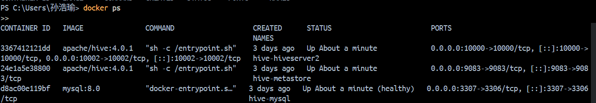
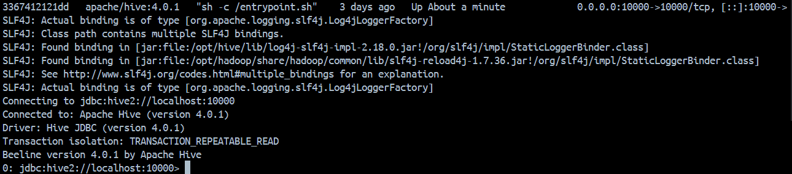
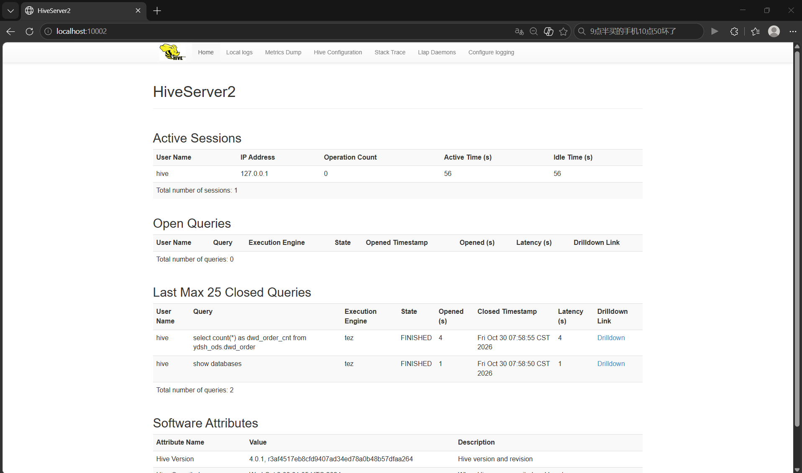

# 环境搭建笔记（第 1 周）

> 记录 Docker / Hive / MySQL 环境搭建过程中遇到的问题与解决方案。

## 一、环境组成

| 服务 | 镜像 | 容器名 | 端口 | 说明 |
|---|---|---|---|---|
| MySQL | mysql:8.0 | hive-mysql | 3307→3306 | Metastore 元数据库（metastore 库，用户 hive） |
| Hive Metastore | apache/hive:4.0.1 | hive-metastore | 9083 | 元数据服务 |
| HiveServer2 | apache/hive:4.0.1 | hive-hiveserver2 | 10000/10002 | JDBC 查询服务 + Web UI |

启动顺序依赖：MySQL（healthy）→ Metastore（自动建 schema）→ HiveServer2，
由 docker-compose 的 `depends_on: condition: service_healthy` 保证。

## 二、遇到的问题与解决

### 问题 1：Docker Hub 拉取镜像超时
- **现象**：`docker compose up -d` 报 `dial tcp ...registry-1.docker.io:443: connectex` 连接失败。
- **原因**：国内网络无法直连 Docker Hub。
- **解决**：通过 DaoCloud 镜像源拉取后重新打 tag：
  ```bash
  docker pull docker.m.daocloud.io/library/mysql:8.0
  docker pull docker.m.daocloud.io/apache/hive:4.0.1
  docker tag docker.m.daocloud.io/library/mysql:8.0 mysql:8.0
  docker tag docker.m.daocloud.io/apache/hive:4.0.1 apache/hive:4.0.1
  ```

### 问题 2：宿主机 3306 端口被占用
- **现象**：MySQL 容器启动报 `ports are not available ... bind: Only one usage of each socket address`。
- **原因**：本机已安装并运行了 MySQL 服务，占用了 3306。
- **解决**：compose 中端口映射改为 `3307:3306`，宿主机连接元数据库使用 3307。

### 问题 3：Metastore 反复重启（Schema initialization failed）
- **现象**：`docker logs hive-metastore` 显示
  `ClassNotFoundException: com.mysql.cj.jdbc.Driver`。
- **原因**：apache/hive 镜像默认只内置 Derby/PostgreSQL 驱动，使用 MySQL 作为元数据库需自行提供驱动 jar。
- **解决**：下载 `mysql-connector-j-8.0.33.jar` 放入项目 `lib/` 目录，
  compose 中挂载到 `/opt/hive/lib/`，重建 metastore 容器后首次启动自动完成 schema 初始化。

### 问题 4：Docker 自动把挂载点创建成目录
- **现象**：第一次 `up` 时 `./lib/mysql-connector-j-8.0.33.jar` 不存在，Docker 将其创建为**目录**，导致后续复制 jar 失败。
- **解决**：先删除该空目录，再把 jar 以**文件**形式放入，再 `up -d --force-recreate metastore hiveserver2`。

## 三、连通性验证

```bash
docker ps                          # 三个容器 Up / healthy
docker exec hive-hiveserver2 beeline -u jdbc:hive2://localhost:10000 -n hive \
  -e "show databases;"             # 返回 default
```

验证结果：beeline 返回 `default` 库，`create database ydsh_ods` 成功，
HiveServer2 Web UI（http://localhost:10002）可访问。

### 关键截图

图片存放于 `docs/images/`，已在文中嵌入显示。

**图 1　三容器运行状态**



> 截图命令：`docker ps`。要求完整显示三个容器的 NAMES、STATUS（Up、healthy）、PORTS 三列。

**图 2　beeline 连接 HiveServer2**



> 截图命令：`docker exec -it hive-hiveserver2 beeline -u jdbc:hive2://localhost:10000 -n hive`。
> 图中 `Connected to: Apache Hive (version 4.0.1)` 与 `0: jdbc:hive2://localhost:10000>` 提示符表示连接建立成功；
> 查询执行记录见次图（图 3）的 Last Max 25 Closed Queries 一栏，`show databases` 与 `select count(*)` 均为 FINISHED。

**图 3　HiveServer2 Web UI**



> 截图方式：浏览器访问 http://localhost:10002。图中 Active Sessions 显示 1 个活跃会话（用户 hive，来源 127.0.0.1），
> Last Max 25 Closed Queries 记录了 `show databases` 与 `select count(*) ... from ydsh_ods.dwd_order` 两条已执行查询。

**图 4（可选，暂未提供）　MySQL 元数据库连接**

> 截图方式：Navicat 连接 `localhost:3307`（root / root123），展开 `metastore` 库的"表"节点，
> 可见 `DBS`、`TBLS`、`COLUMNS_V2` 等元数据表，用于说明 Metastore 的元数据存放位置。
> 需补充时，将图片保存为 `images/04-navicat-metastore.png` 并在此处用 Markdown 图片语法引用即可。


## 四、验证通过标准核对

- [x] `docker --version` / `docker compose version` 输出版本号
- [x] `docker ps` 可见 mysql、metastore、hiveserver2 三个容器均 Up
- [x] beeline 连接 HiveServer2，`show databases;` 正常
